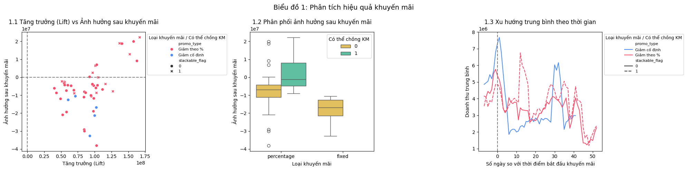
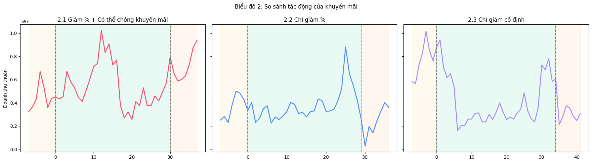
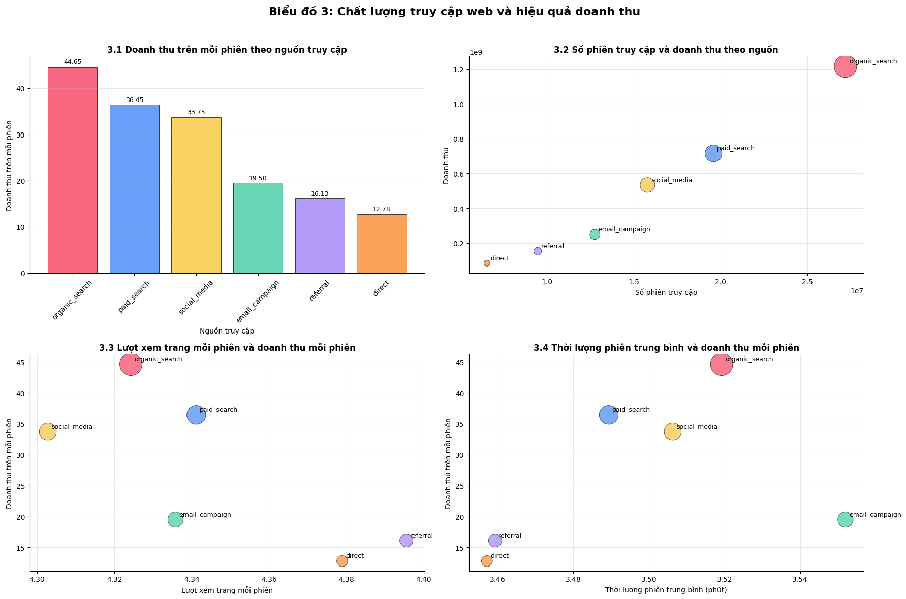
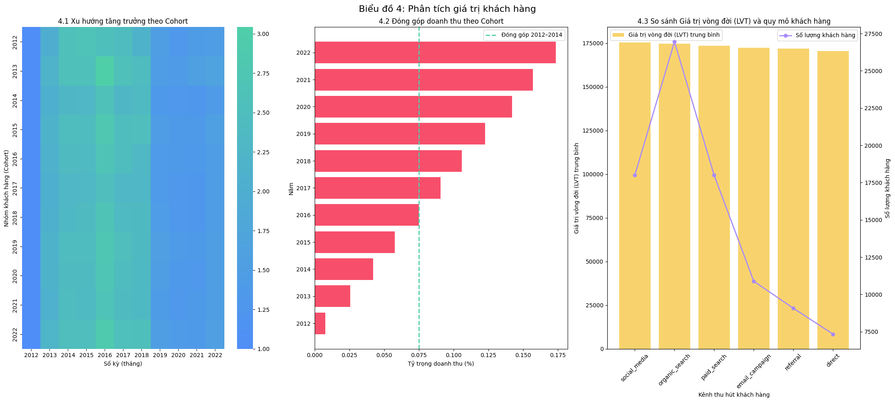
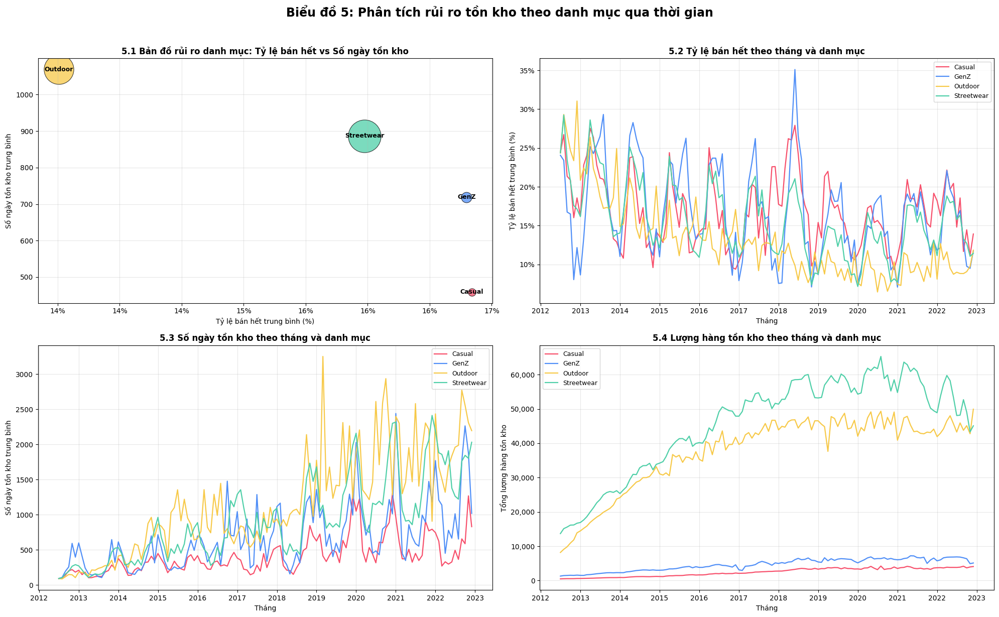
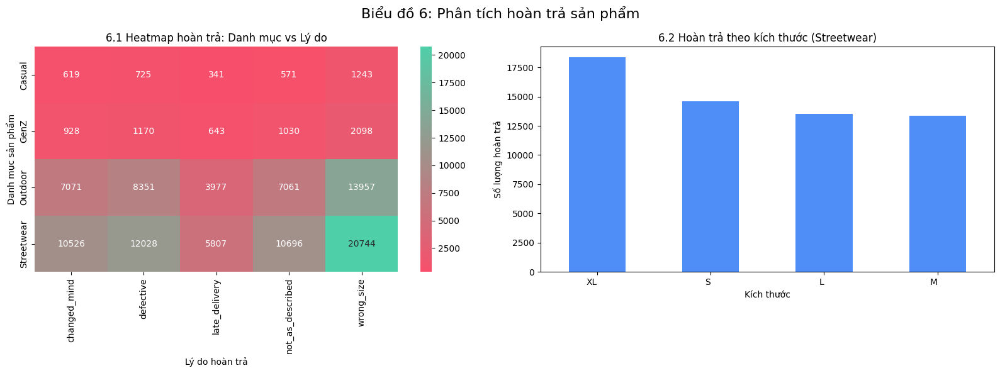
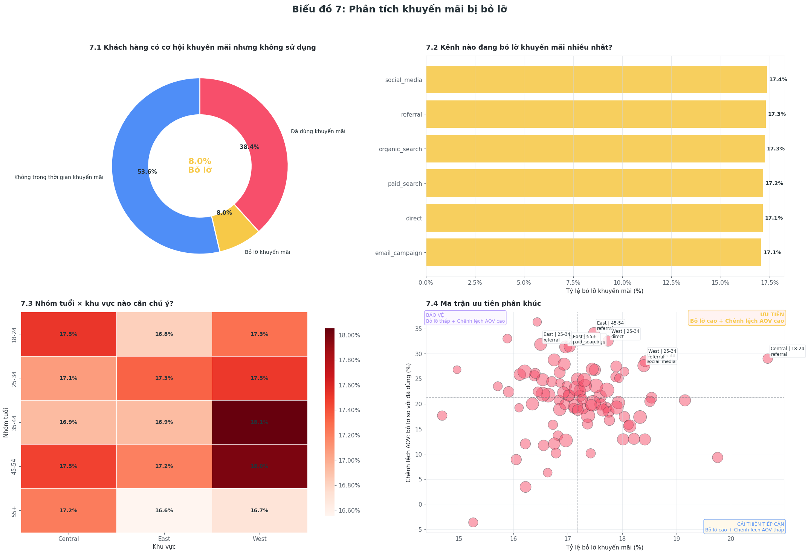

# Retail Business Insights — Datathon 2026

Phân tích khám phá (EDA) dữ liệu của một chuỗi bán lẻ thời trang trong 10 năm (2012–2022): **~647.000 đơn hàng, ~715.000 dòng sản phẩm, ~122.000 khách hàng**. Mục tiêu là trả lời các câu hỏi kinh doanh về khuyến mãi, kênh truy cập, giá trị khách hàng, tồn kho và hoàn trả.

> **Bối cảnh:** Đây là phần mình thực hiện trong bài dự thi của đội **F4ustus** tại *Datathon 2026 — The Gridbreaker* (VinTelligence, VinUniversity DS&AI Club), vòng 1.
> Mình phụ trách notebook **EDA & business insights**. Phần mô hình dự báo doanh thu (XGBoost) do thành viên khác trong đội thực hiện, xem tại [repo của đội](https://github.com/NhClaire/Datathon-2026---F4ustus).

**Công cụ:** Python · pandas · NumPy · Matplotlib · Seaborn

---

## Tóm tắt các phát hiện chính

| # | Câu hỏi | Phát hiện |
|---|---|---|
| 1 | Khuyến mãi có hiệu quả không? | KM **giảm % có thể cộng dồn** cho mức tăng doanh thu cao nhất và **không bị sụt doanh thu sau đợt**. KM giảm cố định kéo doanh thu tuần sau đợt xuống mạnh nhất. |
| 2 | Kênh truy cập nào mang lại doanh thu tốt nhất? | Organic search tạo **44,6 doanh thu/phiên**, gấp **3,5 lần** direct (12,8). Tuy vậy bounce rate, số trang/phiên và thời lượng phiên gần như **bằng nhau** giữa các kênh. |
| 3 | Khách hàng nào có giá trị cao? | LTV gần như như nhau giữa các kênh thu hút (170–175 nghìn). Các kênh khác nhau về **số lượng** khách, không khác về **chất lượng** khách. |
| 4 | Danh mục nào có rủi ro tồn kho? | **Outdoor** có tỷ lệ bán hết thấp nhất (~14%) và tồn kho ~1.070 ngày, là danh mục rủi ro cao nhất. Số ngày tồn kho của mọi danh mục tăng rõ rệt từ 2018. |
| 5 | Vì sao khách trả hàng? | **Sai kích cỡ** là lý do số 1 ở cả 4 danh mục. Streetwear size **XL** bị trả nhiều nhất. |
| 6 | Ai đang bỏ lỡ khuyến mãi? | **51.686 đơn (17,2% số đơn trong thời gian KM)** không áp dụng KM dù đang có chương trình. Tỷ lệ này đồng đều ở mọi kênh, cho thấy vấn đề nằm ở trải nghiệm hoặc truyền thông chứ không ở riêng kênh nào. |

---

## 1. Hiệu quả khuyến mãi

So sánh doanh thu thuần 7 ngày **trước**, **trong** và 7 ngày **sau** mỗi đợt khuyến mãi, theo loại KM và việc có cho cộng dồn hay không.



| Loại KM | Lift trung bình (trong − trước) | Ảnh hưởng sau đợt (sau − trước) |
|---|---|---|
| Giảm %, cộng dồn được | **+106,9 triệu** | **+2,4 triệu** |
| Giảm %, không cộng dồn | +86,2 triệu | −7,7 triệu |
| Giảm cố định | +85,6 triệu | **−18,8 triệu** |

**Insight:** KM giảm cố định tạo hiệu ứng "kéo cầu về trước": khách dồn mua trong đợt rồi doanh thu tuần sau sụt mạnh. KM giảm % cho phép cộng dồn vừa có lift cao nhất vừa giữ được doanh thu sau đợt.

**Đề xuất:** Ưu tiên cơ chế giảm % có thể cộng dồn. Hạn chế KM giảm cố định, hoặc gắn thêm ưu đãi cho lần mua sau để giảm mức sụt sau đợt.



## 2. Chất lượng truy cập web và doanh thu



| Nguồn | Doanh thu/phiên | Tỷ lệ chuyển đổi |
|---|---|---|
| organic_search | 44,6 | 0,19% |
| paid_search | 36,5 | 0,15% |
| social_media | 33,8 | 0,14% |
| email_campaign | 19,5 | 0,08% |
| referral | 16,1 | 0,07% |
| direct | 12,8 | 0,05% |

**Insight:** Các chỉ số tương tác (bounce rate ~0,45%, ~4,3 trang/phiên, ~3,5 phút/phiên) gần như không khác nhau giữa các nguồn, nên không giải thích được chênh lệch doanh thu. Yếu tố quyết định là **ý định mua** của người dùng: khách tìm kiếm (organic/paid search) chuyển đổi tốt hơn hẳn.

**Đề xuất:** Tăng đầu tư SEO/SEM. Với email và referral, nên tối ưu nội dung và landing page để tăng chuyển đổi thay vì chỉ kéo thêm traffic.

## 3. Giá trị khách hàng



- Doanh thu của mọi cohort biến động **theo cùng một nhịp thời gian**: tăng đến 2016 rồi giảm từ 2019. Biến động đến từ yếu tố thị trường chung chứ không phải từ việc khách cũ rời bỏ.
- Nhóm khách đăng ký 2012–2014 chỉ đóng góp **7,5%** tổng doanh thu.
- LTV trung bình giữa các kênh chỉ chênh ~3% (social_media 175,5 nghìn và direct 170,5 nghìn). Vì vậy chi phí thu hút khách (CAC) của từng kênh mới là yếu tố nên dùng để phân bổ ngân sách.

## 4. Rủi ro tồn kho



- **Outdoor**: tỷ lệ bán hết ~14%, tồn kho ~1.070 ngày, có nguy cơ tồn đọng cao nhất.
- **Streetwear**: lượng tồn lớn nhất (đỉnh ~65.000 đơn vị), ~880 ngày tồn kho.
- **Casual**: tình trạng tốt nhất (~16,7% bán hết, ~460 ngày).
- Từ 2018, số ngày tồn kho tăng đều ở mọi danh mục trong khi tỷ lệ bán hết giảm. Lượng nhập hàng chưa được điều chỉnh theo nhu cầu đang giảm.

**Đề xuất:** Giảm lượng nhập và chạy chương trình xả hàng cho Outdoor. Lập kế hoạch nhập hàng theo dự báo nhu cầu thay vì theo xu hướng tăng trưởng cũ.

## 5. Hoàn trả sản phẩm



- `wrong_size` là lý do trả hàng nhiều nhất ở mọi danh mục. Riêng Streetwear có **20.744** sản phẩm bị trả vì lý do này.
- Trong Streetwear, size **XL** bị trả nhiều nhất (~18.300), cao hơn hẳn S, M, L.

**Đề xuất:** Cải thiện bảng size và thêm công cụ gợi ý size, ưu tiên Streetwear size XL.

## 6. Ai đang bỏ lỡ khuyến mãi?

Một đơn được tính là "bỏ lỡ" khi đặt trong thời gian có chương trình KM nhưng không áp dụng mã nào.



- **51.686 đơn** bị bỏ lỡ, chiếm 8,0% tổng số đơn và **17,2%** số đơn đặt trong thời gian KM.
- Tỷ lệ bỏ lỡ gần như bằng nhau ở mọi kênh (17,1–17,4%), nên đây là vấn đề **hệ thống** chứ không riêng kênh nào.
- Cao nhất ở khu vực **West, nhóm 35–54 tuổi** (~18%).
- Ở các phân khúc ưu tiên, giá trị đơn trung bình (AOV) của đơn bỏ lỡ **cao hơn 28–34%** so với đơn có dùng KM.

**Đề xuất:** Hiển thị và tự động gợi ý mã KM khi thanh toán. Tập trung nhắc KM cho các phân khúc nằm ở góc "Ưu tiên" của ma trận 7.4.

---

## Cấu trúc repo

```
├── eda_retail_insights.ipynb   # Notebook phân tích (đã có sẵn output)
├── images/                     # Biểu đồ xuất từ notebook
├── dataset/                    # Đặt dữ liệu cuộc thi vào đây (không kèm theo repo)
└── requirements.txt
```

## Cách chạy

```bash
pip install -r requirements.txt
# Đặt các file CSV của cuộc thi vào thư mục dataset/
jupyter notebook eda_retail_insights.ipynb
```

Dữ liệu do Ban tổ chức Datathon 2026 cung cấp nên không được đưa vào repo này.
